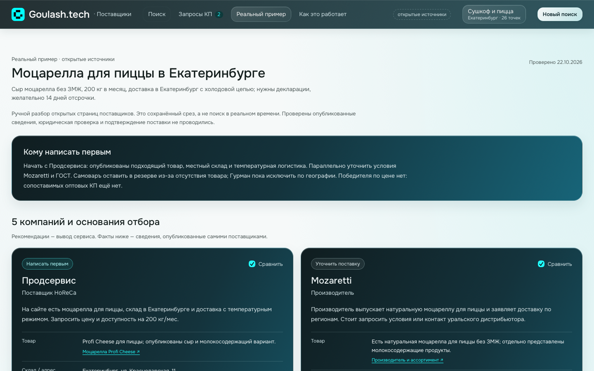
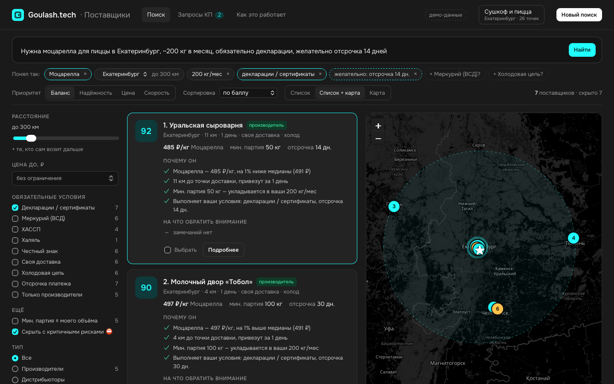
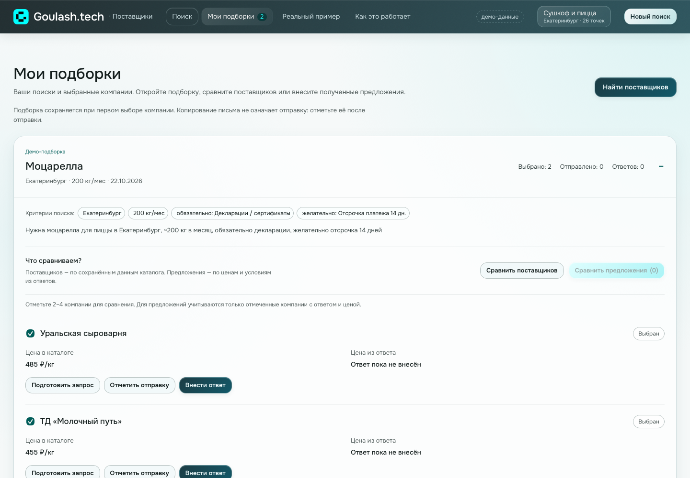

# Goulash · Поставщики

Веб-сервис для руководителя закупок или директора сети общепита. Он помогает быстро найти, проверить и сравнить поставщиков продуктов, ингредиентов, готовой еды и упаковки, а затем запросить у лучших коммерческие предложения (КП).

Это тестовое задание (часть 2) на вакансию AI-инженера в Goulash.Tech. Условие задания — в [`test.md`](test.md).

**Реальный сценарий:** вкладка «Реальный пример» содержит 5 настоящих компаний для подбора моцареллы в Екатеринбурге. Добавлены реквизиты, статус, регистрация, деятельность и доступная отчётность из Т-Банка, Saby и документов поставщиков. У опубликованных сведений есть ссылки и даты просмотра; доступны сравнение и адресный черновик запроса. Это ручной срез 24 источников от 22.10.2026, с явно указанными ограничениями проверки. Обычный поиск по-прежнему работает на 93 демо-поставщиках. [Подробности и источники](docs/real-case.md).

Открыть после запуска: http://localhost:8000/#real-case.





## Зачем

Анализ ниши и бизнеса лежит в [`docs/report.md`](docs/report.md), болевые точки — в [`plan.md`](plan.md). Коротко:

- **Надёжный поставщик важнее дешёвого.** Сальмонелла у фабрики-поставщика Жизньмарта в 2024 году обернулась −22% выручки, а основатель опасался, что тот же владелец вернётся через новые юрлица. Поэтому сервис проверяет юрлицо, его связи и документы и прямо показывает риски.
- **Поставщиков ищут вручную.** Ищут в соцсетях и по звонкам, а в каждом новом городе или стране собирают заново. Сервис принимает фразу вроде «моцарелла, Екатеринбург, 200 кг/мес» и сразу выдаёт шорт-лист с учётом логистики до кухни.
- **Сырьё дорожает.** Средний фудкост — 33%, а 43% рестораторов в 2026 году ищут альтернативных поставщиков. Сервис сравнивает варианты по сути: цена к медиане рынка, минимальная партия против реального объёма, отсрочка и документы.
- **В Goulash.Tech публично нет модуля поставщиков.** Конкуренты работают либо с уже подключёнными поставщиками (Saby, iiko), либо как каталоги без проверки (Supl.biz, Optlist).

## Быстрый старт

Нужны Python 3.11+ и [uv](https://docs.astral.sh/uv/).

```bash
make install   # uv sync
make run       # http://localhost:8000
```

Без `make` то же самое делается так: `uv sync && uv run uvicorn app.main:app --port 8000`.

База SQLite (`data/goulash.db`) создаётся и наполняется демо-данными при первом запуске. Путь к ней задаёт переменная `GOULASH_DB`. Чтобы пересоздать базу, выполните `make seed` или нажмите «Сбросить демо-данные» на странице «Как это работает».

Для публичного демо включите `GOULASH_PUBLIC_DEMO=1`. Если HTTPS завершается на внешнем прокси и приложение получает HTTP, задайте `GOULASH_PUBLIC_ORIGIN=https://ваш-домен` (без пути). Этот адрес используется для проверки Origin и Secure-cookie; запросы с посторонних сайтов остаются запрещены. При смене временного домена обновите значение и перезапустите сервер.

Для CodeSandbox подготовлены Python 3.12 devcontainer, задачи установки/автозапуска и `requirements.txt` из lock-файла. [Инструкция переноса в Python Devbox](CODESANDBOX.md).

Для постоянного размещения на Render подготовлен [`render.yaml`](render.yaml): Docker web service в Frankfurt, один экземпляр `0.5c-512mb`, постоянный диск 1 ГБ для SQLite и сессий, health check `/api/meta`. Это платные вычислительные ресурсы и диск; актуальную стоимость Render показывает перед созданием. Публичный Origin определяется автоматически из `RENDER_EXTERNAL_URL`, отдельно вводить домен не нужно.

[Развернуть на Render](https://render.com/deploy?repo=https%3A%2F%2Fgithub.com%2FVovaArrow%2Fgoulash_test%2Ftree%2Ffeature%2Fsupplier-search)

Для сервера:

```bash
docker compose up --build   # база в ./data
```

> Docker-образ на машине разработки не собирался, потому что Docker там не установлен. Dockerfile стандартный: python:3.12-slim + uv.

## Демо-сценарий за 2 минуты

1. Нажмите первый пример: «Нужна моцарелла для пиццы в Екатеринбург, ~200 кг в месяц, обязательно декларации, желательно отсрочка 14 дней».
2. **Понял так.** Чипы показывают, как разобран запрос:
   - товар, город и радиус, объём;
   - обязательное условие (сплошная рамка) и желательное (пунктир);
   - подсказки сервиса «+ Меркурий?» и «+ Холодовая цепь?». Они не применяются, пока вы на них не нажмёте.
3. **Шорт-лист.** Первой идёт «Уральская сыроварня» с баллом 92. У каждого поставщика две колонки, «Почему он» и «На что обратить внимание», с подсказками к каждому пункту. На карте видны точка доставки ★, радиус и поставщики. Внизу списка блок «Скрыто 7» объясняет, кого и почему отсеяли. Там же есть кнопка «Показать с критичными рисками»: она покажет «ООО «СырПром»» — юрлицу 4 месяца, есть связь с ликвидированной компанией с санкциями Роспотребнадзора.
4. **Карточка поставщика.** Нажмите «Подробнее»:
   - балл по четырём частям с весами;
   - вердикт надёжности со счётчиками ⛔ ⚠ ✓ и фактами по группам, у каждого блока — источник данных;
   - документы со сроком действия;
   - заметки команды.
5. **Сравнение.** Отметьте «Уральскую сыроварню» и «ТД «Молочный путь»» и нажмите «Сравнить». Лучшее значение в каждой строке отмечено ★, внизу — вывод: «…«Молочный путь» дешевле на 6%, но мин. партия 300 кг при потребности 200 кг даст излишки…».
6. **Мои подборки.** При выборе первой компании поиск сохраняется вместе с критериями. Откройте «Мои подборки» и разверните нужную потребность: внутри находятся выбранные компании.
7. **Сравните поставщиков** по сохранённым условиям каталога. Кнопка «Подготовить запрос» собирает письмо; открытие почты или копирование текста не отмечает отправку. После фактической отправки нажмите «Отметить отправку».
8. **Внесите ответы.** У каждой компании нажмите «Внести ответ»: цена за единицу товара, условия доставки/оплаты и заметка. После двух ответов с ценами станет доступно **«Сравнить предложения»**. В этой таблице используются только внесённые ответы, без подстановки каталожной цены.



Подборки доступны напрямую: http://localhost:8000/#collections. Выбор компаний в реальном примере сохраняется в таком же формате, отдельно от демо-поисков. Старые запросы КП переносятся с ценами и заметками; исходные записи и история событий остаются в базе. Если исходные критерии старого запроса не сохранены, сравнение цен недоступно до нового поиска на конкретный товар.

В демо также подготовлены три разные потребности: куриное филе (600 кг/мес), рис для суши (400 кг/мес) и контейнеры для роллов (10 000 шт./мес). В каждой по четыре компании: два вымышленных ответа для сравнения предложений, один отправленный запрос и одна выбранная компания. Условия ответов помечены как демонстрационные. Эти примеры восстанавливаются при сбросе демо-данных.

## Как устроено

```
Браузер: SPA без сборки (Alpine.js + Leaflet), стиль goulash.tech
   │ JSON
FastAPI (app/api.py)
   ├── app/ai/       протоколы QueryParser · Explainer · KPWriter
   │                 и их реализация на правилах (app/ai/rules.py)
   ├── app/search.py источник кандидатов SupplierSource → жёсткие фильтры с причинами скрытия
   │                 → медиана цены → балл → сортировка, счётчики фильтров, подсказки ослабления
   ├── app/scoring.py балл, флажки ✓⚠⛔ с подсказками, отчёт о надёжности, логистика
   └── app/db.py     SQLite на чистом SQL; app/seed.py — генератор демо-базы
```

**Балл 0–100** — взвешенная сумма четырёх частей, каждая от 0 до 100:

| Приоритет | Соответствие запросу | Надёжность | Цена | Логистика |
|---|---|---|---|---|
| Баланс (по умолчанию) | 30 | 30 | 20 | 20 |
| Надёжность | 25 | 45 | 10 | 20 |
| Цена | 25 | 20 | 40 | 15 |
| Скорость | 25 | 20 | 15 | 40 |

Что входит в каждую часть:
- **Соответствие запросу:** есть ли нужный товар, укладывается ли минимальная партия в ваш объём, выполнены ли желательные условия.
- **Надёжность:** возраст компании, производитель или дистрибьютор, действующие документы, «Меркурий», ХАССП, отзывы. Минусуют суды, долги, банкротство, массовый адрес и связи с проблемными компаниями. При любом критичном риске надёжность не выше 40.
- **Цена:** относительно медианы найденных предложений. 80% медианы и дешевле дают 100, 130% и дороже — 0. Если цена «по запросу», ставится нейтральная оценка 50.
- **Логистика:** расстояние до точки доставки, срок, своя доставка, холодовая цепь для охлаждённых товаров.

**Обязательные и желательные условия.** Обязательные работают как жёсткий фильтр: кто не проходит, скрыт, и сервис показывает, сколько поставщиков и почему. Желательные только влияют на балл.

## Что в прототипе настоящее, а что мок

| | Сейчас | В продукте |
|---|---|---|
| Данные о поставщиках | 93 выдуманных поставщика в обычном поиске; 5 реальных компаний в отдельном сценарии со ссылками на источники | 2ГИС Places API или Яндекс Поиск по организациям по рубрикам и городу, фильтр по ОКВЭД 10.xx и 46.3x |
| Проверка юрлица | Мок-поля | DaData (ИНН, ОКВЭД, статус), Checko API (суды, ФССП, банкротства), открытые данные ФНС (долги, массовые адреса); в Казахстане — stat.gov.kz и КГД |
| Документы | Мок | Открытые реестры деклараций и сертификатов ФСА, ВетИС «Цербер» |
| Разбор запроса, «почему он», письмо КП | Правила и словари, без внешних API | LLM за теми же протоколами |
| Отправка КП | Ссылки `mailto:`, `wa.me`, Telegram, статусы вручную | Отправка из системы, разбор входящих КП и автозаполнение цены |

Настоящие здесь логика поиска, фильтров, балла, рисков, сравнения и писем, хранение заметок, подборок и ответов поставщиков, а также весь интерфейс.

### Как подключить реальные данные и LLM

- **Источник поставщиков.** Нужен новый класс с методом `candidates(criteria) -> list[Supplier]` по протоколу `SupplierSource` из `app/search.py`, например «2ГИС + DaData + ФСА». Его передают в `run_search(..., source=...)`. Остальной код не меняется.
- **LLM.** Нужны классы с теми же методами, что у `RuleBasedQueryParser`, `RuleBasedExplainer` и `RuleBasedKPWriter`, по протоколам из `app/ai/base.py`. Модель возвращает `Criteria` строго по Pydantic-схеме, а правила остаются запасным вариантом, если модель недоступна.
- **Следующий шаг по данным** (из [`plan.md`](plan.md)): агент читает сайт и прайс найденного поставщика и извлекает ассортимент, цены, минимальную партию и условия, а у каждого поля сохраняет ссылку на источник.

## Почему такой формат и стек

- **Веб-сервис, а не бот.** Шорт-лист, карта, сравнение в таблице и карточки с фактами удобнее смотреть на большом экране. Мобильная версия тоже есть.
- **Python, FastAPI, SQL, Pydantic.** Это стек из вакансии. Типизированные модели — общий контракт между поиском, «AI»-слоем и API.
- **SQLite.** Не требует настройки, база — один файл, заменяется на Postgres без изменения запросов к домену.
- **Фронт без сборки** (Alpine.js и Leaflet лежат в `static/vendor`). Его проще править и запускать, Node.js не нужен. Карта на OpenStreetMap, ключ не нужен.
- **Правила вместо LLM в демо.** Демо работает без ключей и интернета (кроме тайлов карты), а результат детерминирован и проверяется тестами. Протоколы оставляют место для LLM.
- **Интерфейс по мотивам конкурентов** (разбор — в [`docs/research/competitors-ux.md`](docs/research/competitors-ux.md)):
  - колонки «Почему он / На что обратить внимание» — Keychain;
  - вердикт надёжности со счётчиками — Rusprofile и Checko;
  - нижняя панель выбора — Thomasnet;
  - подсказки ослабления фильтров — Контур.Компас.

## Тесты

```bash
make test      # 130 тестов: разбор запроса, балл и флажки, поиск, тексты, API
make e2e       # сквозной демо-сценарий в WebKit при запущенном сервере
uv run --with playwright python scripts/e2e_real_case.py  # реальный сценарий, без отправки сообщений
GOULASH_E2E_URL=http://localhost:18080/ uv run --with playwright python scripts/e2e_collections.py  # подборки, на отдельной тестовой базе
```

## Структура

```
app/         бэкенд: models, catalog, db + schema.sql, seed, scoring, search, ai/, api, main
static/      фронт: index.html, app.js, styles.css, logo.svg, vendor/
tests/       pytest
scripts/     e2e_flow.py — сквозной сценарий в браузере
docs/        report.md (анализ ниши), research/ (досье и разбор конкурентов), screenshots/, real-case.md
plan.md      болевые точки и план развития
CHANGELOG.md лог изменений
```

## Текст для HR

> Добрый день! Отправляю тестовое задание (часть 2): сервис поиска и сравнения поставщиков продуктов питания.
>
> Прототип: http://localhost:8000. Запускается одной командой `make install && make run`, инструкция в README.
> Репозиторий: <ссылка на репозиторий>
>
> Сначала я разобрал нишу и бизнес группы (Жизньмарт, Сушкоф, Goulash.Tech) и выделил главную боль: ненадёжный поставщик обходится дороже, чем дорогой. Отчёт лежит в `docs/report.md`, болевые точки — в `plan.md`.
>
> Сервис устроен так:
> - Руководитель закупок пишет потребность обычной фразой, а сервис раскладывает её на критерии.
> - Сервис собирает шорт-лист с объяснимым баллом: соответствие запросу, надёжность, цена к медиане рынка, логистика до кухни. Отдельно показаны риски: молодое юрлицо, долги, связи с проблемными компаниями, просроченные декларации.
> - Есть карта, сравнение 2–4 поставщиков с выводом простыми словами и готовый запрос КП каждому поставщику в его канал. Выбранные компании и ответы сохраняются в «Моих подборках»; поставщики и полученные предложения сравниваются отдельно.
>
> Стек: Python, FastAPI, SQLite (SQL), Pydantic; фронт на Alpine.js и Leaflet без сборки. Данные пока демонстрационные. В README описано, какие реальные источники подключаются (2ГИС, DaData, Checko, ФНС, ФСА) и где в архитектуре встаёт LLM.
