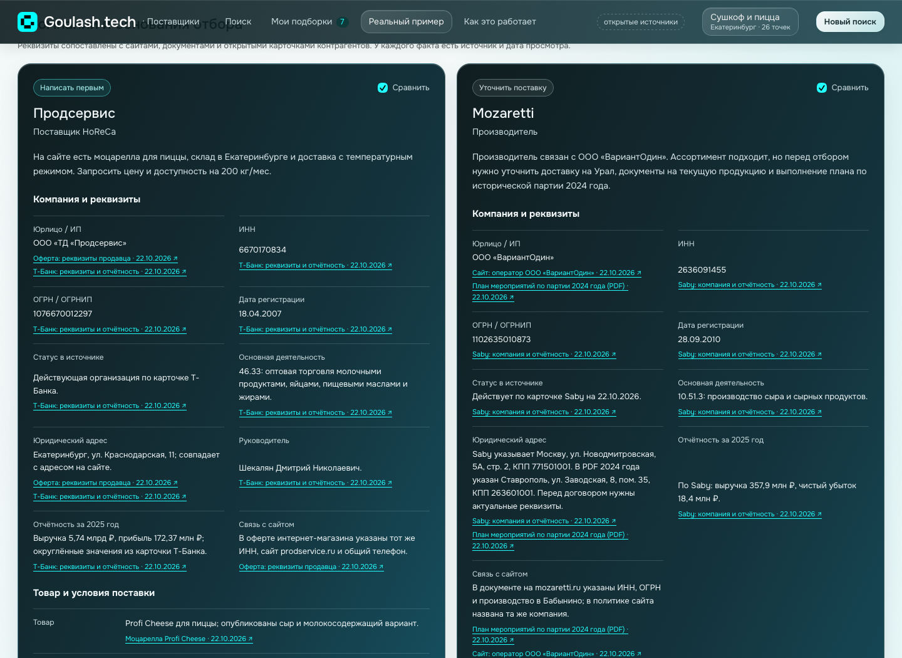

# Реальный сценарий: моцарелла для пиццы в Екатеринбурге

Срез открытых сайтов проверен 22.10.2026. Цель: найти кандидатов для запроса КП на сыр без ЗМЖ, 200 кг в месяц, с доставкой и холодовой цепью; нужны декларации, желательна отсрочка 14 дней.

Это ручная проверка опубликованных сведений, не автоматический веб-поиск. Наличие, цены и условия могут измениться. Реквизиты сопоставлены с документами сайтов и открытыми карточками Т-Банка и Saby. Прямая сверка арбитража, ФССП, банкротства и действующих деклараций в государственных реестрах не проводилась; поставщикам сообщения не отправлялись.

## Компания и реквизиты

Для всех пяти компаний добавлены название юрлица/ИП, ИНН, ОГРН/ОГРНИП, дата регистрации, опубликованный статус, основной ОКВЭД и основания связи с сайтом. Отчётность показана с указанием года; отсутствие показателей у ИП не приравнивается к нулю. Всего в сценарии 24 страницы-источника, включая PDF.

| Поставщик | Контрагент | Карточка контрагента |
|---|---|---|
| Продсервис | ООО «ТД «Продсервис», ИНН 6670170834, ОГРН 1076670012297 | [Т-Банк](https://www.tbank.ru/business/contractor/legal/1076670012297/) |
| Mozaretti | ООО «ВариантОдин», ИНН 2636091455, ОГРН 1102635010873 | [Saby](https://saby.ru/profile/2636091455-771501001) |
| ГОСТ | ИП Ховренок Дмитрий Александрович, ИНН 710511011093, ОГРНИП 312715432600101 | [Saby](https://saby.ru/profile/710511011093) |
| Самоваръ | ИП Мошкин Илья Владимирович, ИНН 667472827715, ОГРНИП 314667911800082 | [Т-Банк](https://www.tbank.ru/business/contractor/legal/314667911800082/) |
| Гурман | ООО «ТД «Гурман», ИНН 7728383263, ОГРН 5177746097645 | [Saby](https://saby.ru/profile/7728383263-772801001) |

Основания сопоставления находятся в поле `identity` и связанных источниках JSON. Для Гурмана связь с доменом найдена через [каталог с ИНН, сайтом и телефоном](https://optsbyt.ru/supplier/gurman); реквизиты продавца нужно подтвердить в договоре. Одноимённые компании с другими ИНН не смешиваются. Для Ховренка используется регистрация 2012 года, не прежний ОГРНИП того же предпринимателя.

У Mozaretti показаны расхождения юридического адреса и КПП между документом 2024 года и Saby, а также выручка и чистый убыток за 2025 год. Перед договором нужны актуальные реквизиты. На сайте найден [план от 25.10.2024](https://mozaretti.ru/upload/iblock/7c2/lc3c28afhcnvln83m7py29g18arx83pp.pdf) с мероприятиями по отзыву партии моцареллы 45% от 10.06.2024 из-за несоответствия состава. Это сведения о конкретной исторической партии, не доказательство нарушений в текущих поставках. Результат выполнения плана не найден; вопрос включён в черновик. Документ не считается действующей декларацией.

В [общих условиях Продсервиса](https://prodservice.ru/about/) найдены заявления об отсрочке и работе с «Меркурием». Срок 14 дней и декларация на конкретный сыр не подтверждены.

Поиск карточек Rusprofile и доступ к Checko через инструмент исследования оказались недоступны; они не указаны как источники проведённой проверки. Локальная проверка URL отдельно фиксирует ошибки TLS для Т-Банка и Saby; сведения прочитаны через веб-инструмент. Проверка доступности не подменяет проверку фактов.

## Результат отбора

| Компания | Действие | Основание и источники |
|---|---|---|
| Продсервис | Написать первым | [Подходящий ассортимент](https://prodservice.ru/special/233.html), [местный адрес](https://prodservice.ru/about/contact/), [температурная логистика](https://prodservice.ru/transport/). Нужно явно выбрать сыр без ЗМЖ и запросить условия на наш объём. |
| Mozaretti | Уточнить документы и поставку | [Производитель и ассортимент](https://mozaretti.ru/), [контакты](https://mozaretti.ru/kontakty/). Запросить результат мероприятий 2024 года, документы на текущую продукцию, прямую поставку или контакт уральского дистрибьютора. |
| ГОСТ / ИП Ховренок | Уточнить логистику | [Товар в каталоге](https://ekb.gostpp.ru/katalog/syry/mocarella/), [обслуживание через Тулу](https://ekb.gostpp.ru/kontakty.html). Региональная страница не подтверждает местный склад. |
| Лавка Самоваръ | Резерв | В [карточке](https://samovar-lavka.ru/offer/syr-mocarella-picca-40-1kg-brus-1-8-tm-anton-palych,-turovskiy-mk-bzmzh--9108) товар отсутствует, цена розничная. Условия в [таблице доставки](https://samovar-lavka.ru/delivery) расходятся с карточкой по порогу бесплатной доставки. |
| ТД «Гурман» | Исключить из первичного списка | [Ассортимент подходит](https://gurman-llc.ru/catalog/syry/filter/cheese_type-is-mocarella/apply/), но [опубликованная доставка](https://gurman-llc.ru/payment/) относится к Москве и ближайшей области; [адрес и контакты](https://gurman-llc.ru/contacts/). Маршрут в Екатеринбург не подтверждён. |

Победитель по цене не выбран: сопоставимых оптовых предложений нет. Отсутствие документа на просмотренной странице не означает отсутствие документа у компании. Рекомендация связаться первой не является оценкой юридической надёжности.

## Как посмотреть

Откройте `http://localhost:8000/#real-case` или кнопку «Посмотреть реальный подбор» на главной.

У каждого опубликованного поля есть ссылка на источник. Неизвестные условия подписаны явно. Можно сравнить 2–3 компании и подготовить адресный запрос, учитывающий обнаруженные пробелы. Текст можно изменить, скопировать или открыть в своей почте. Выбранные компании сохраняются в «Моих подборках» вместе с источниками. Подготовка текста не отмечает отправку: её нужно подтвердить вручную. Там же можно внести ответы и сравнить полученные цены отдельно от условий сайта. Если профиль содержит демонстрационный e-mail `.example`, черновик использует поля-заготовки вместо названия и контактов демо-компании.

## Воспроизводимость

- Данные: `app/fixtures/real_case.json`. Даты привязаны к источникам, а не генерируются текущим днём.
- Контракт и проверка ссылок на источники: `app/real_case.py`.
- API: `GET /api/real-case`, `POST /api/real-case/{supplier_id}/draft`.
- Проверка доступности: `uv run python scripts/check_real_sources.py`. Отчёт в `data/real-source-check.json` содержит HTTP-статус, итоговый URL, заголовок, время проверки и SHA-256 ответа. Доступность страницы не является автоматической перепроверкой её условий.
- Тесты: `make test`. Браузер: `uv run --with playwright python scripts/e2e_real_case.py` при работающем сервере.

При обновлении нужно перечитать страницы, изменить факты и даты в JSON, проверить выводы и повторить тесты. Полные копии страниц не включены в репозиторий.
